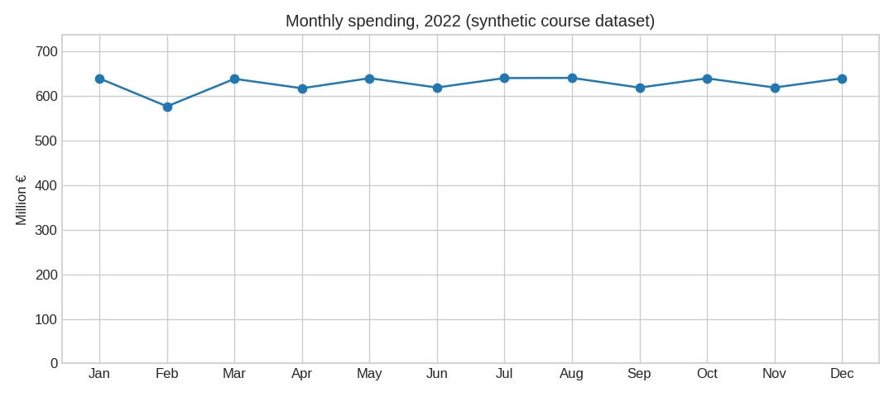
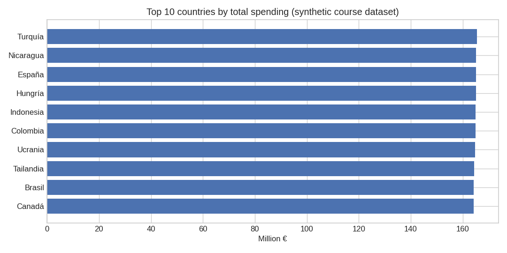
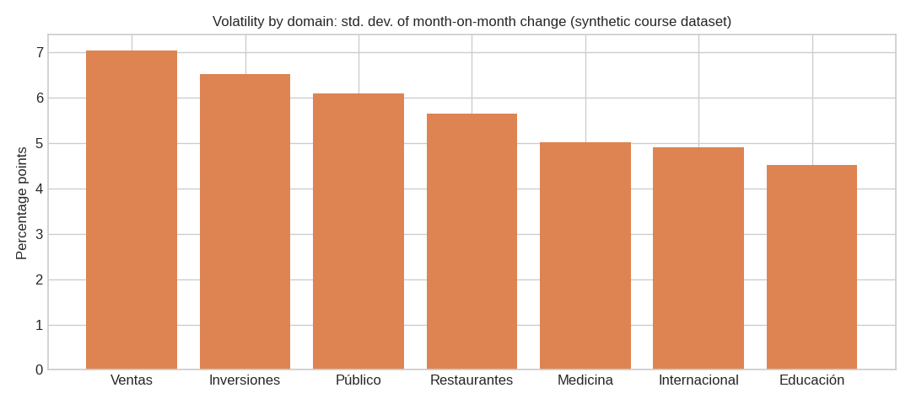

# Bank transactions analysis with PySpark

Final project of the *Microcredential in Data Science, Big Data, AI & Business Intelligence* (University of Jaén, 2025).
It is an ETL and analysis pipeline written in PySpark over about one million synthetic bank transactions.

> **Read this first.** The data is synthetic and was provided by the course. The "countries" are Indian cities relabelled by the assignment, and spending per country is almost uniform (every country is between 161 and 166 million €). The results below are **not business insights**. What the project shows is the pipeline: cleaning, derived columns, joins, window functions and reproducible exports.

## What the notebook does

| Phase | Content |
|---|---|
| 1. Cleaning | Value mappings (location to country, domain to Spanish), real date type, normalization of amounts, transaction type from a key. |
| 2. Exploitation | Currency conversions (USD, JPY, INR), management costs with a commission per transaction type, EU membership, tariffs for non-EU countries, local taxes (join with the countries table), countries that could join the EU. |
| 3. Summary tables | Spending by country, month and domain; top 3 EU countries by taxes; countries that could be in crisis. |
| 4. Questions and exports | Six analysis questions answered with a string, CSV exports prepared for Power BI, and charts. |

Everything is in [`notebooks/ProyectoFinal.ipynb`](notebooks/ProyectoFinal.ipynb), already executed. Column and domain names are in Spanish because they come from the assignment; code and comments are in English.

## Results at a glance

These come from the full dataset (see [Data](#data)). The text is in [`results/respuestas.txt`](results/respuestas.txt).

1. The gap between the highest month (August, 640.9 M €) and the lowest (February, 577.0 M €) is 63.9 M €.
2. Among the countries not in crisis, Argentina has the highest spending per transaction: 5.13 €.
3. 49.53 % of the 18,654 international transactions in countries with local taxes above 12 % cost more to manage than the EU average.
4. Quarter-on-quarter changes in efficiency are tiny (the largest is -0.0007 %), because management costs are the amount plus a very small commission.
5. Australia has the highest crisis-risk index among non-crisis countries (0.74 on a 0-1 scale). This is a heuristic ranking, not a probability.
6. Ventas is the most volatile domain (month-on-month standard deviation of 7.04 percentage points).





The charts start their axes at zero on purpose: with this dataset the differences are small, and truncated axes would make them look large.

## Repository layout

```
notebooks/ProyectoFinal.ipynb   the pipeline, executed
data/                           sample of the transactions + countries table (see data/README.md)
results/                        CSV exports (one file per table), respuestas.txt, figures/
requirements.txt
```

CSV files in `results/` use plain numbers (comma separator, dot decimals) so they can be loaded directly in Power BI. The Power BI report itself is not part of this repository.

## How to run

You need Java (Spark 3.5 supports 8, 11 and 17; the executed outputs in the notebook were produced with Java 21) and Python 3.10 or later.

```bash
python -m venv .venv && source .venv/bin/activate
pip install -r requirements.txt jupyterlab
jupyter lab notebooks/ProyectoFinal.ipynb
```

Without further setup the notebook uses `data/bankdataset_sample.csv` (10,000 rows), so its numbers will differ from the ones above. To reproduce them exactly, copy the full transactions file to `data/bankdataset.csv` (see [Data](#data)).

The outputs saved in the notebook were generated with PySpark 3.5.5, Python 3.12 and Java 21, on the full file.

## Data

- `data/bankdataset_sample.csv`: 10,000 random rows (seed 42) of the transactions file.
- `data/paises.csv`: 46 countries with local tax rate and crisis flag (converted to UTF-8).
- The full transactions file (1,004,480 rows, one year of data) is **not included** because I have not checked its license. See [`data/README.md`](data/README.md).

## Changes made after the course submission

I revisited the original notebook and fixed the following:

- **A join dropped 8 countries.** The assignment's mapping writes some names without spaces (`CoreadelSur`), while `paises.csv` uses spaces (`Corea del Sur`). The left join left those countries without tax rate or crisis flag, and they were silently ignored in the queries that depend on them. The mapping now uses the names in `paises.csv`, and the notebook asserts that no row is left unmatched.
- **Czech Republic was not recognized as an EU member** (the EU list had `Chequia`, the data has `República Checa`). Fixed, and the list is checked to have 27 entries.
- **Amounts stayed as numbers.** The original converted amounts to European-formatted strings and parsed them back with Python UDFs in every step, and it rounded the average amount before computing fees. Now columns are numeric, European notation is applied only when displaying tables, and no UDFs are used.
- **Questions 6.1 and 6.2 printed `Column<...>` objects** instead of numbers. Fixed.
- **Question 6.4** returned "no significant variations" because of an arbitrary filter. It now reports the real quarter-on-quarter changes and explains why they are tiny.
- **Question 6.5** mixed indicators with different units in one weighted sum. The three indicators are now scaled to 0-1 first. It remains a heuristic, and the notebook says so.
- **Question 6.6** uses a simpler, documented definition of volatility.
- Removed the `pip install` output and local paths, added an explicit schema and sanity checks (unmapped values, unparsed dates, unmatched joins), and added charts and single-file CSV exports.

## Limitations

- Synthetic data, one year, no real countries.
- Several definitions come from the assignment and are questionable. For example `Total_Gastos_Gestion` contains the whole amount plus the commission, so the "taxes" ranking mostly follows total spending, and the one-million threshold for crisis candidates is met by every country.
- The crisis-risk index has arbitrary weights and no model behind it.
- Spark runs in local mode on one machine; the code is not tuned for a cluster.
- There are no automated tests. The checks are assertions inside the notebook.

## License

Code under the [MIT License](LICENSE). The datasets belong to the course and are included only as a sample.
